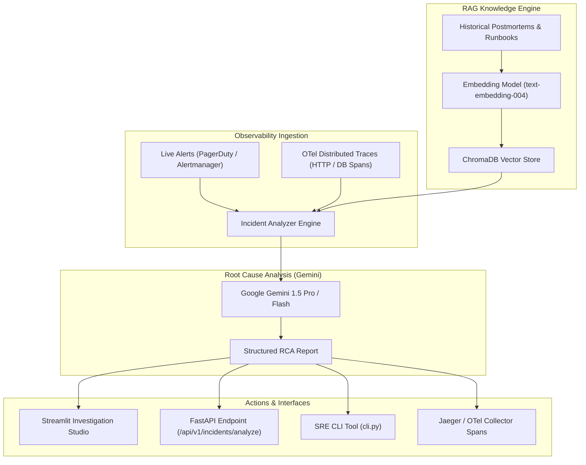

# SRE Observability RAG with OpenTelemetry & Google Gemini 🛡️⚡

[](https://github.com/myadvbalaji-commits/sre-observability-rag/actions/workflows/ci.yml)
[](https://opentelemetry.io/)
[](https://aistudio.google.com/)
[](https://opensource.org/licenses/MIT)

A production-grade, AI-augmented Site Reliability Engineering (SRE) incident investigation platform. It automatically correlates incoming alerts and OpenTelemetry distributed traces with historical postmortems and SOP runbooks using Retrieval-Augmented Generation (RAG) powered by Google Gemini.

---

## 🏗️ Architecture Overview



---

## ✨ Key Capabilities

- **Automated Root-Cause Analysis (RCA):** Ingests error traces (e.g., HTTP 502, exit code 137 OOMKilled, PostgreSQL lock timeouts) and infers root causes with probabilistic confidence scoring.
- **RAG Across Historical Incidents:** Indexes past incident postmortems and standard operating procedure (SOP) runbooks into ChromaDB with semantic retrieval.
- **Full OpenTelemetry Semantic Conventions:** Every diagnosis span is instrumented with GenAI semantic conventions (`gen_ai.system`, `gen_ai.request.model`, `incident.id`, `service.name`) and exported over OTLP gRPC/HTTP.
- **Interactive Operations Studio:** Streamlit-powered incident commander dashboard for visual triage and prompt evaluation.
- **Production-Ready REST API & CLI:** FastAPI service with OpenAPI docs and a terminal CLI for DevOps pipelines.

---

## 🚀 Quick Start

### 1. Prerequisites
- Python 3.10+
- (Optional) Docker & Docker Compose
- (Optional) Google Gemini API Key from [Google AI Studio](https://aistudio.google.com/)

### 2. Local Setup
```bash
# Clone the repository
git clone https://github.com/myadvbalaji-commits/sre-observability-rag.git
cd sre-observability-rag

# Create virtual environment
python -m venv venv
# On Windows:
.\venv\Scripts\activate
# On Linux/macOS:
source venv/bin/activate

# Install dependencies
pip install -r requirements.txt

# Configure your environment
cp .env.example .env
# Edit .env and paste your GEMINI_API_KEY (optional; system includes fallback vectors for local testing)
```

### 3. Run with Docker Compose (Full Stack)
Spin up the FastAPI service, Streamlit Dashboard, OpenTelemetry Collector, and Jaeger UI:
```bash
docker-compose up --build
```
- **Streamlit Studio:** [http://localhost:8501](http://localhost:8501)
- **FastAPI OpenAPI Docs:** [http://localhost:8000/docs](http://localhost:8000/docs)
- **Jaeger UI (Traces):** [http://localhost:16686](http://localhost:16686)

---

## 🛠️ CLI Usage

Diagnose an incident alert from the terminal:
```bash
python cli.py diagnose sample_data/alerts/alert-high-latency-checkout.json
```

Search indexed postmortems and runbooks:
```bash
python cli.py search "database connection saturation PgBouncer"
```

---

## 📡 API Reference

### Health Check
`GET /health`
```json
{
  "status": "healthy",
  "service": "sre-incident-rag-service",
  "environment": "production",
  "indexed_documents": 5
}
```

### Analyze Incident
`POST /api/v1/incidents/analyze`
```json
{
  "incident_id": "INC-8941",
  "title": "High HTTP 502 Rate and Pod Restarts in checkout-service",
  "severity": "P1",
  "service": "checkout-service",
  "trace_sample": {
    "failing_span": "checkout-service.processOrder",
    "error_message": "Command terminated: exit status 137 (OOMKilled)"
  }
}
```

Response:
```json
{
  "incident_id": "INC-8941",
  "confidence_score": 0.94,
  "root_cause_summary": "Container memory limit reached in checkout-service; kernel OOM killer triggered.",
  "similar_past_incidents": ["incident-101-k8s-oom-exhaustion"],
  "immediate_mitigation_steps": [
    "1. Verify active pod status via kubectl get pods -l app=checkout-service",
    "2. Execute emergency resource bump or restart command",
    "3. Monitor OpenTelemetry error span rates for 5 minutes"
  ],
  "mitigation_commands": [
    "kubectl set resources deployment/checkout-service -n production --limits=memory=2Gi --requests=memory=1Gi"
  ]
}
```

---

## 🧪 Testing

Run automated tests:
```bash
pytest tests/ -v
```

---

## 📄 License
MIT License.
